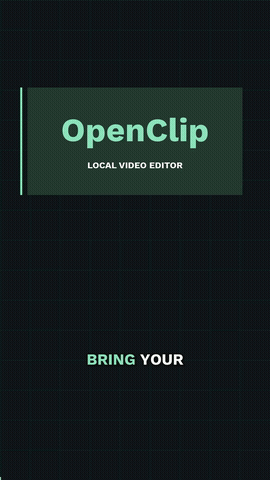

# OpenClip

Turn a long stream, a podcast or any recording into captioned, edited Shorts (9:16) or regular videos (16:9), on your own computer.

Paste a public YouTube link or drop in a video file. OpenClip transcribes it locally, finds the best moments, edits each one with the template you choose, and exports ready-to-post MP4s. If you want, it also writes titles with AI and schedules the uploads to your YouTube channel.



*The demo is original graphics with synthetic audio, made to show the caption renderer.*

- **Runs locally.** Transcription (Whisper), editing and rendering (FFmpeg) all happen on your machine. No account and no API key are required.
- **Finds moments for you.** Laughs, hype words, loud reactions and pauses rank every part of the stream. Each pick gets the setup it needs before the payoff.
- **15 edit templates**, including two meme edits (Meme Reveal and Skull Ending) built from frame-by-frame measurements of viral Shorts.
- **Optional AI.** A free Gemini or Groq key adds AI titles, descriptions and tags. For meme templates, the same key picks the moments that actually work as that meme.
- **Edit everything.** Trim on words, fix captions, cut out the middle, add zooms, freezes, replays, sounds and labels.
- **Post it.** A posting calendar with private-by-default YouTube uploads and scheduling.

---

## 1. Install the requirements

You need four programs. Install them once, and make sure each one is on your `PATH`.

| Program | Version | Where to get it |
| --- | --- | --- |
| Node.js | 24 LTS | <https://nodejs.org/> |
| Python | 3.12 (or [uv](https://docs.astral.sh/uv/getting-started/installation/)) | <https://www.python.org/downloads/> |
| FFmpeg and ffprobe | A **full** build with the `libass` subtitle filter | <https://ffmpeg.org/download.html> (on Windows, the "full" build from gyan.dev works) |
| Git | Any | <https://git-scm.com/downloads> |

Check them in a terminal (PowerShell on Windows):

```powershell
node --version      # v24.x
python --version    # 3.12.x
ffmpeg -version
ffprobe -version
```

> Use a drive with free space: Whisper models, downloads and renders can take several GB. OpenClip keeps all of its caches, models, uploads and temporary files **inside the project folder**.

## 2. Download and set up

```powershell
git clone https://github.com/jaspher19/open-clip-editor.git
cd open-clip-editor
npm ci --cache .cache/npm
npm run setup          # creates .venv and installs the Python workers (faster-whisper, yt-dlp)
npm run setup:faces    # optional: face-follow framing model
npm run build          # builds the web app
```

`npm run setup` checks that FFmpeg has `libass`. If it says FFmpeg needs the libass filter, install a full FFmpeg build and run it again.

## 3. Start the app

```powershell
npm start
```

Open **<http://localhost:5173>** in your browser. Leave the terminal open while you use the app; press `Ctrl+C` to stop it.

The first transcription downloads the Whisper model you picked (the `small.en` default is about 0.5 GB). On a CPU, transcribing an hour of video takes several minutes or more.

## 4. Make your first clips

1. **Your video.** Paste a public YouTube link, or drop an MP4, MOV, MKV, WebM or M4V file (up to 4 GB). You can add a line of context, for example *"A costume challenge at a Halloween party"*.
2. **Edit style.** Choose **Meme edit** or **Standard clips**, then pick a template. Each card plays a preview.
3. **Moments.** Choose how many clips you want (or *Auto*, about one per 11 minutes of video). Then press the start button.

OpenClip downloads (or uploads), transcribes, finds the moments and edits every one. When it's done, each clip is ready to download or post. Open any clip to change it:

- Click transcript words to set the start and end, or to fix a caption.
- Change the template, font, caption position, colours, motion and hook text in **Templates & style**.
- Add effects on the timeline: zoom, shake, flash, freeze, replay, sound, pop text and *ACTION* labels.
- Swap a clip for the next-best moment, or pick a range yourself on the stream timeline.
- Export again after any change, then download the MP4 (with SRT captions and a title file), or all clips as a ZIP.

## Templates

| Template | Best for |
| --- | --- |
| Context Hit | Who / what / payoff, with a context line |
| Word Punch | Actions and quick reactions |
| White Editorial | A headline over wide footage |
| Reaction Context | Set-up, reaction, result |
| Ranked Moments | A real 2–5 clip countdown |
| Boxed Word | IRL chaos |
| Yellow Box Reveal | Suspense reveals |
| Facecam Word | Calls and reactions |
| Rainbow Hype | Challenges and battles |
| Rainbow Rapid | Fast reactions |
| Neon Phrase | Story setups |
| Lowercase Rage | Rage and meme edits |
| Letterbox Raw | Long story clips |
| **Meme Reveal** *(meme edit)* | 11–24 s clips: the frame freezes in silence, then the reveal lands with a flash and a boom. Green and red tints on yes and no, and *ACTION* labels. |
| **Skull Ending** *(meme edit)* | 12–25 s clips that end on the punchline, then freeze with a smear, a warm glow, flames, an animated skull and a slow 808 beat. |

Meme templates pick their own kind of moment (short, with the payoff where the format needs it). With an AI key set, the AI chooses the best of up to 30 candidates. Without one, the local picker chooses.

Templates are starting points. Every setting can be changed per clip, and **Apply to kept** restyles a whole project at once.

## Optional: AI titles and smarter meme picks

Copy the example settings file and add **one** key (free options are listed first):

```powershell
copy .env.example .env      # macOS/Linux: cp .env.example .env
```

| Setting in `.env` | What it does | Cost |
| --- | --- | --- |
| `GEMINI_API_KEY` | AI titles, descriptions and tags, plus meme moment picking | Free tier: <https://aistudio.google.com/app/apikey> |
| `GROQ_API_KEY` | Same features, used as a backup if Gemini is busy | Free tier: <https://console.groq.com/keys> |
| `ANTHROPIC_API_KEY` | Same features with Claude, plus the optional Claude clip picker | Paid |
| `OPENAI_API_KEY` | Optional OpenAI clip picker | Paid |
| `METADATA_AI` | Leave blank to use the first key that's set, or force `gemini`, `groq` or `claude` | |
| `YOUTUBE_REGION` | Two-letter country for the trending chart used as title-style context | |

Restart the app after editing `.env`. AI features send transcript text to the provider you chose. Your keys stay in `.env` on your computer, and `.env` is never committed. Always review AI titles for names and facts before posting.

## Optional: posting to YouTube

1. In [Google Cloud Console](https://console.cloud.google.com/), create a project and enable **YouTube Data API v3**.
2. Set up the OAuth consent screen and add your Google account as a **test user**.
3. Create an **OAuth client ID** of type **Desktop app** and save its JSON inside this project's `.cache/` folder (it is ignored by Git).
4. In OpenClip, open **Automation**, load that JSON and click **Connect YouTube** (the browser asks for your consent once).
5. Open **Posting calendar**, add edited clips (or any finished MP4), edit the title, description and tags, and save drafts.
6. Select drafts and press **Upload selected**. Uploads are **private by default**. A scheduled post uploads now and YouTube publishes it at the time you set. New Google Cloud projects may be limited to private uploads until Google audits them.

An upload log stops the same file from being uploaded twice, unless you choose **Upload anyway**. Scheduled times currently use UTC+8. See [docs/AUTOMATION.md](docs/AUTOMATION.md) for live-stream capture, repeatable automation scripts and their limits.

## Command line

```powershell
npm run clip -- "path\to\recording.mp4" --model small.en --count 3   # clip a file without the browser
npm run automate -- docs/automation/example-script.json --watch      # run a saved automation (app must be running)
npm run setup:references                                             # optional: cache the public reference Shorts for side-by-side comparison
```

## Troubleshooting

- **Captions don't render, or setup complains about libass.** Install a full FFmpeg build and make sure it's first on your `PATH`.
- **A YouTube link fails.** YouTube changes often. Run `npm run setup` to update yt-dlp, or download the video and drop the file in instead. Private, members-only and DRM videos aren't supported.
- **Face follow falls back to center.** Run `npm run setup:faces`. Dark scenes, side profiles and fast motion can still fall back to center.
- **Port 5173 is in use.** Set `PORT=5180` (or another free port) in `.env`.
- **Disk space.** Each project lives in `work/<project id>/`. Stop the app before deleting a project folder.
- **Picks need review.** Automatic picks and Whisper text are suggestions; this isn't a views predictor. Only edit footage and music you have permission to use.

## Development

```powershell
npm run dev       # Vite on 5173, API on 5174, with reload
npm test          # unit tests (node --test)
npm run lint      # syntax checks for every JavaScript module
npm run build     # type check and production bundle
.venv\Scripts\python -m unittest discover -s workers -p "test_*.py"   # macOS/Linux: .venv/bin/python
node scripts/make-sfx.mjs   # rebuild the original synthesized meme sounds
```

Layout: `server/` (Express API, pipeline, renderer), `web/` (React app), `workers/` (Python transcription and face tracking), `presets/` (templates and caption styles), `assets/` (fonts and sounds) and `site/` (static landing page). The edit data model is documented in [docs/EDIT-CONTRACT.md](docs/EDIT-CONTRACT.md).

Contributions are welcome. Good starting points: moment selection quality, more languages, accessible transcript editing and CPU performance.

## License

MIT for the original project code; see [LICENSE](LICENSE). Fonts, sounds, dependencies and external programs keep their own licenses; see [THIRD_PARTY_NOTICES.md](THIRD_PARTY_NOTICES.md). The meme sounds and the skull artwork are original and generated in code; no third-party videos, music or branding are included.
