# OpenClip

Turn a long stream, a podcast or any recording into captioned, edited Shorts (9:16) or regular videos (16:9), on your own computer.

Paste a public YouTube, Twitch or Kick link (a past broadcast, a clip, or a YouTube or Twitch stream that is still live) or drop in a video file. OpenClip transcribes it locally, finds the best moments, edits each one with the template you choose, and exports ready-to-post MP4s. If you want, it also writes titles with AI and schedules the uploads to your YouTube channel.

## Spare me some change ☕

OpenClip is free and made by one person, **Jaspher Tampos**. If it saves you time, a small tip keeps it going. Scan with any InstaPay bank or e-wallet (GCash, Maya, BPI, BDO and more).

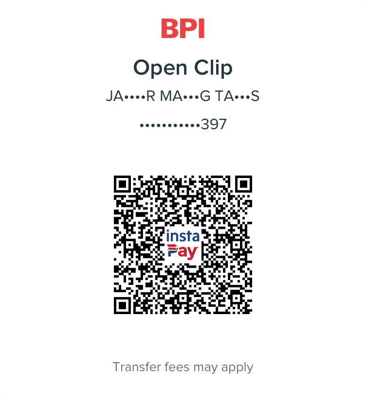

## See it in action

All three clips were made by OpenClip from one 12-minute film, *Tears of Steel* (credited below). The app transcribed it, found the moments and edited them; only the on-screen hook text was typed by hand. Click a preview to watch the full MP4 with sound.

| Skull Ending *(meme edit)* | Meme Reveal *(meme edit)* | Context Hit *(standard)* |
| :---: | :---: | :---: |
| [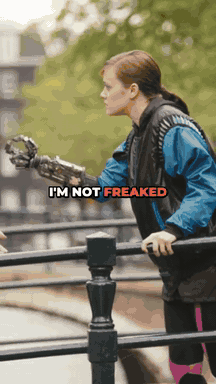](docs/media/example-skull-ending.mp4) | [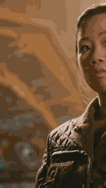](docs/media/example-meme-reveal.mp4) | [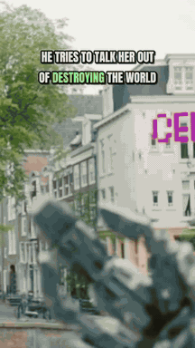](docs/media/example-context-hit.mp4) |
| Ends on the punchline, then a smear into a held frame with a warm glow, flames, an animated skull and an 808 beat | The frame freezes in silence, then the reveal lands with a flash and a boom; green and red tints on the shouted lines | A hook title, then the setup and the payoff, with word-by-word captions |

### Screenshots

| | |
| :---: | :---: |
| 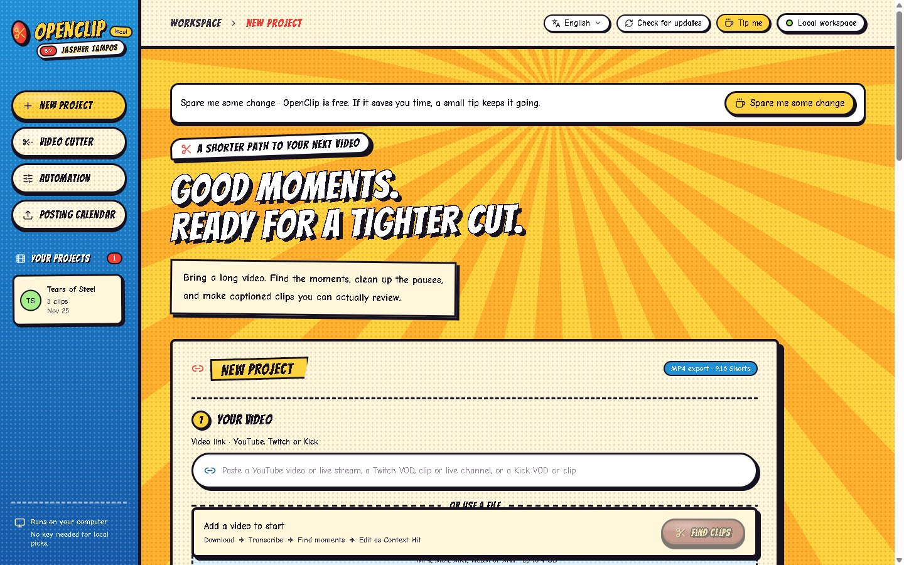 | 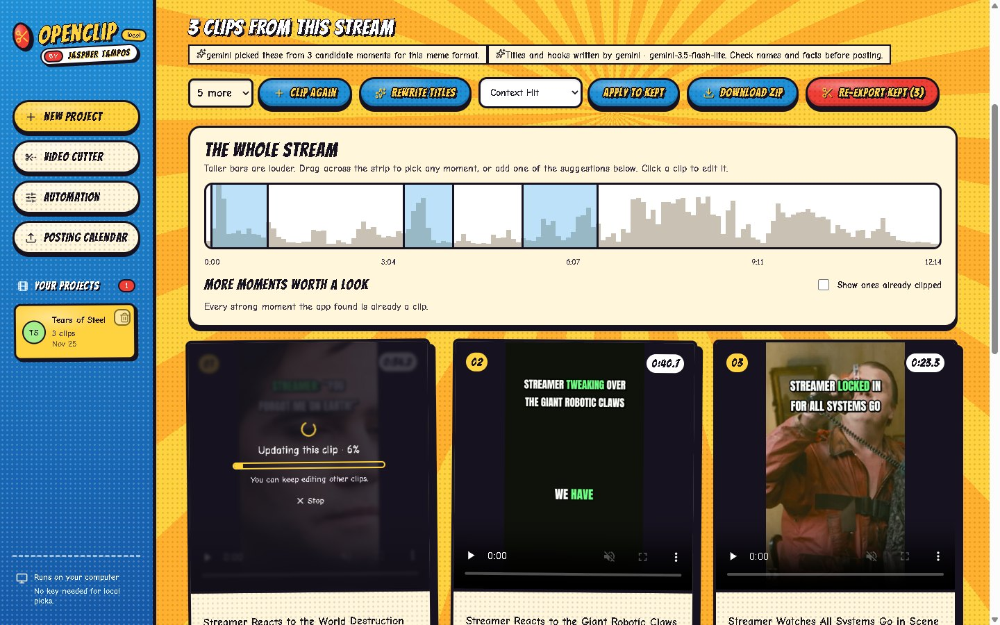 |
| **New project:** your video, an edit style, how many moments | **Your clips:** edited and ready, with the whole-stream timeline above |
| 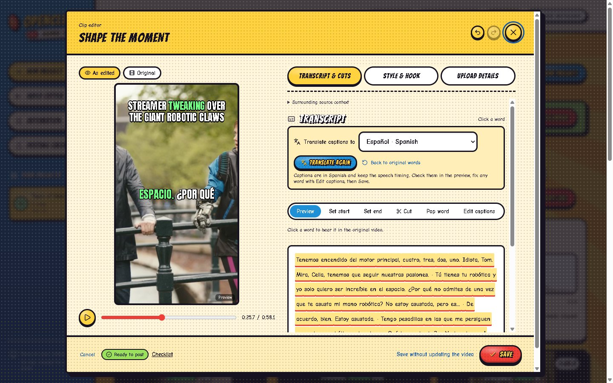 | 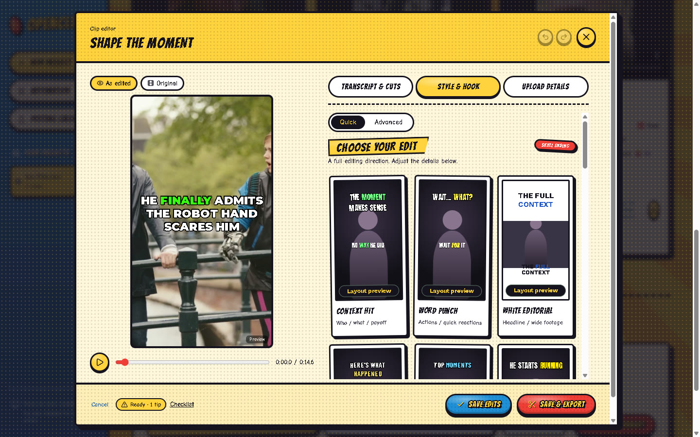 |
| **Clip editor:** trim and cut on words, fix captions | **Style & hook:** switch templates, fonts, colours and motion |

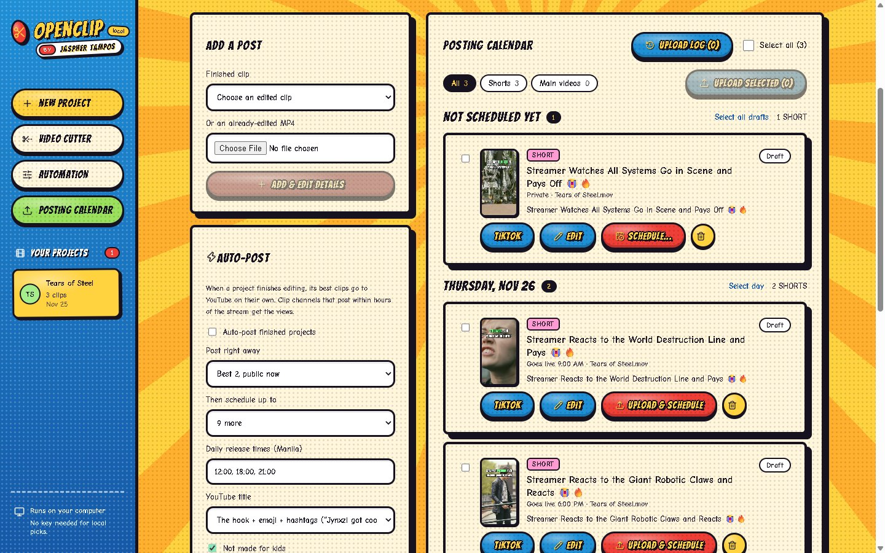

**Posting calendar:** edit titles and descriptions, schedule, and upload privately to YouTube.

### New: Video cutter, raw clips and portrait or landscape

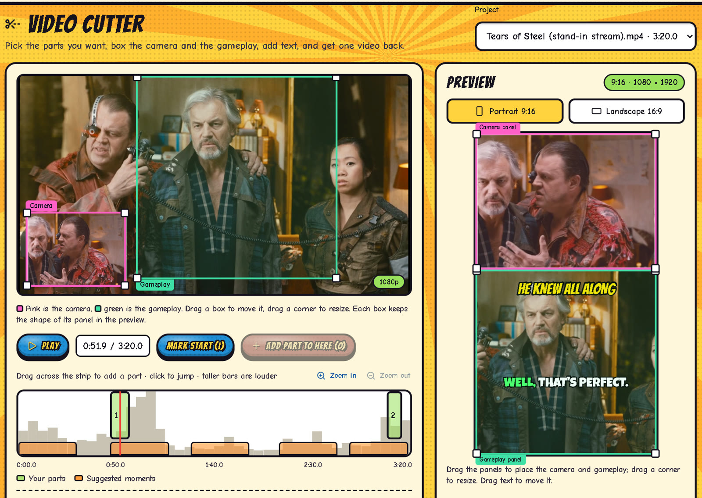

**Video cutter:** pick parts on the loudness timeline, box the camera and the gameplay on the video, and see the finished Short live, with your caption on it.

| | |
| :---: | :---: |
| 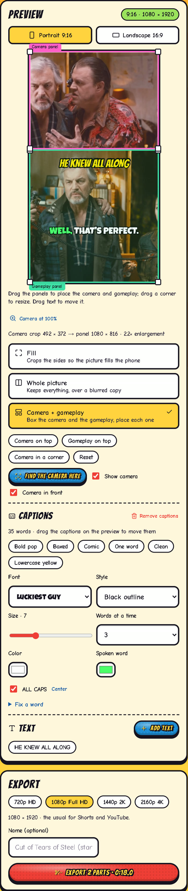 | 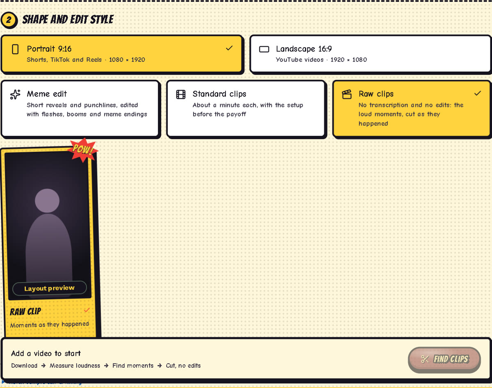 |
| **Layout, text and quality:** presets, Find the camera, captions in 8 fonts, export in 720p, 1080p or 2K | **New project:** choose 9:16 or 16:9 first, then a meme edit, standard clips or raw clips (no transcription, no edits) |

## What it does

- **Runs locally.** Transcription (Whisper), editing and rendering (FFmpeg) all happen on your machine. No account and no API key are required.
- **Finds moments for you.** Laughs, hype words, "clip that", loud reactions, busy on-screen action and (for Twitch) live chat going wild rank every part of the stream. Each pick gets the setup it needs before the payoff, and silent action like a chase is kept instead of trimmed as a pause.
- **18 edit templates**, including facecam layouts for streams (Cam Split, Glow Card), two meme edits (Meme Reveal and Skull Ending) built from frame-by-frame measurements of viral Shorts, and **Raw Clip**: no transcription and no edits, just the loudest and busiest moments cut as they happened.
- **Portrait or landscape.** Choose 9:16 (Shorts, TikTok, Reels) or 16:9 (YouTube videos) before you start. Every template follows the shape you chose.
- **Video cutter.** Cut any parts of a video into one MP4: drag across the loudness timeline or mark with I and O, add suggested moments, reorder, box the camera and the gameplay and place them, add text in any of 8 fonts, and export in 9:16 or 16:9 exactly as the live preview shows.
- **Optional AI.** A free Gemini or Groq key adds AI titles, descriptions and tags, and lets the AI choose the best moments from the picker's candidates.
- **Edit everything.** Trim on words, fix captions, cut out the middle, add zooms, freezes, replays, sounds and labels.
- **Checks every export.** Too quiet, clipping sound, black or frozen picture, or blurry footage get a warning on the clip before you post.
- **Post it.** A posting calendar with YouTube uploads and scheduling, and optional **auto-post**: when a project finishes, the best clips upload right away and the rest are spread over the next days.
- **Learns from your channel.** Once you have a few uploads, OpenClip reads their view counts and favours the kinds of moments your channel does best with.

---

## 1. Install the requirements

You need four programs. Install them once, and make sure each one is on your `PATH`.

OpenClip is developed and tested on Windows 11; macOS and Linux should work but are less tested. No graphics card is needed. Plan for about 10 GB of free disk space.

| Program | Version | Where to get it |
| --- | --- | --- |
| Node.js | 24 LTS | <https://nodejs.org/> |
| Python | 3.12 (or [uv](https://docs.astral.sh/uv/getting-started/installation/)) | <https://www.python.org/downloads/> |
| FFmpeg and ffprobe | A **full** build with the `libass` subtitle filter | <https://ffmpeg.org/download.html> (on Windows, the "full" build from gyan.dev works) |
| Git | Any | <https://git-scm.com/downloads> |

FFmpeg must be a **full** build: the captions are drawn with its `libass` subtitle filter, and cut-down builds leave it out.

### Windows 11

Open **PowerShell** and run these four commands. `winget` comes with Windows 11.

```powershell
winget install OpenJS.NodeJS.LTS
winget install Python.Python.3.12
winget install Gyan.FFmpeg
winget install Git.Git
```

**Close PowerShell and open a new window** so it finds the new programs.

Without winget, use the installers instead:

- **Node.js:** the LTS installer from <https://nodejs.org/>.
- **Python 3.12:** the installer from <https://www.python.org/downloads/>. On its first screen, tick **Add python.exe to PATH**.
- **FFmpeg:** download `ffmpeg-release-full.7z` from <https://www.gyan.dev/ffmpeg/builds/>. Unzip it somewhere permanent, such as `C:\ffmpeg`, then add its `bin` folder to your `PATH`:
  1. Open *Start*, search for **Edit environment variables for your account**, and open it.
  2. Choose *Path*, then *Edit*, then *New*.
  3. Enter `C:\ffmpeg\bin` and click *OK*.
- **Git:** the installer from <https://git-scm.com/downloads>.

### macOS

Install [Homebrew](https://brew.sh/) if you don't have it, then run:

```bash
brew install node ffmpeg git uv
```

Homebrew's own Python can be newer than the transcriber supports. With `uv` installed, `npm run setup` downloads Python 3.12 into the project instead.

### Linux (Ubuntu or Debian)

```bash
sudo apt update
sudo apt install -y python3 python3-venv ffmpeg git curl
curl -fsSL https://deb.nodesource.com/setup_24.x | sudo -E bash -
sudo apt install -y nodejs
```

Ubuntu 24.04 comes with Python 3.12. On older releases, install uv (below) and setup will use it instead. Without uv, if `npm run setup` can't find Python, run it as `PYTHON=python3 npm run setup`.

### Optional: uv

[uv](https://docs.astral.sh/uv/getting-started/installation/) can stand in for a separate Python install. When `uv` is installed, `npm run setup` uses it, and uv downloads Python 3.12 into the project for you.

- **Windows:** `winget install astral-sh.uv`
- **macOS and Linux:** `curl -LsSf https://astral.sh/uv/install.sh | sh`

### Check everything

In a new terminal (PowerShell on Windows), run:

```powershell
node --version      # v24.x (v20.19 or newer works)
python --version    # 3.12.x (3.11 to 3.13 work; macOS/Linux: python3 --version)
ffmpeg -version
ffprobe -version
git --version
```

To check that your FFmpeg has `libass`:

- **Windows:** `ffmpeg -hide_banner -filters | findstr " ass "`
- **macOS and Linux:** `ffmpeg -hide_banner -filters | grep " ass "`

The check should print a line containing `ass`. If it prints nothing, your FFmpeg is a cut-down build. Install the full build as described above.

### What setup installs for you

You don't install any of these by hand:

- **Python packages:** `npm run setup` installs [faster-whisper](https://github.com/SYSTRAN/faster-whisper) (transcription) and [yt-dlp](https://github.com/yt-dlp/yt-dlp) (YouTube, Twitch and Kick downloads) into `.venv` inside the project.
- **Face-follow model:** `npm run setup:faces` installs it (optional).
- **Whisper models:** they download the first time you transcribe.

None of these need a GPU, and yt-dlp uses your Node.js for YouTube, so you don't need anything else.

> Use a drive with free space: Whisper models, downloads and renders can take several GB. OpenClip keeps all of its caches, models, uploads and temporary files **inside the project folder**.

## 2. Download and set up

```powershell
git clone https://github.com/jaspher19/open-clip-editor.git
cd open-clip-editor
npm ci --cache .cache/npm
npm run setup          # creates .venv and installs the Python workers (faster-whisper, yt-dlp)
npm run setup:faces    # optional: face-follow framing model
npm run build          # builds the web app
```

`npm run setup` checks that FFmpeg has `libass`. If it says FFmpeg needs the libass filter, install a full FFmpeg build and run it again.
## 3. Start the app

```powershell
npm start
```

Open **<http://localhost:5173>** in your browser. Leave the terminal open while you use the app; press `Ctrl+C` to stop it.

The first transcription downloads the Whisper model you picked (the `small.en` default is about 0.5 GB). On a CPU, transcribing an hour of video takes several minutes or more.

## 4. Make your first clips

1. **Your video.** Paste a public YouTube video or live stream, a Twitch VOD, clip or live channel, or a Kick VOD or clip, or drop an MP4, MOV, MKV, WebM or M4V file (up to 4 GB). Streams longer than 90 minutes (up to 30 hours) download as a light 360p copy for finding moments; each finished clip is then rendered from a 1080p download of just that part of the stream. A Twitch or Kick clip link becomes one edited clip. **Live streams:** paste a YouTube live link or a Twitch channel that is live, and everything streamed so far is imported (an 11-hour stream takes about 8 minutes at 360p); clips render from 1080p fetched straight from the live stream. Paste again later for the newer part. Kick only shares the last few seconds while live, so paste a Kick stream once it has ended. A Twitch channel must save past broadcasts. Streams over 2 hours get a **fast scan**: a quick draft of the whole stream finds the likely moments, and only those (about a fifth of the stream) are transcribed properly. Add a moment anywhere on the timeline and that part is transcribed on the spot. Choose *Full transcript* under *Long streams* if you want every word. You can add a line of context, for example *"A costume challenge at a Halloween party"*.
2. **Shape and edit style.** Choose **Portrait 9:16** or **Landscape 16:9**, then **Meme edit**, **Standard clips** or **Raw clips**, and pick a template. Each card plays a preview. Your shape stays when you switch templates. In 16:9 the whole picture is kept; the facecam, letterbox and white-canvas layouts only apply to 9:16.
3. **Moments.** Choose how many clips you want (or *Auto*, about one per 11 minutes of video). Then press the start button.

OpenClip downloads (or uploads), transcribes, finds the moments and edits every one. When it's done, each clip is ready to download or post. Open any clip to change it:

- Click transcript words to set the start and end, or to fix a caption.
- Change the template, font, caption position, colours, motion and hook text in **Templates & style**.
- Add effects on the timeline: zoom, shake, flash, freeze, replay, sound, pop text and *ACTION* labels.
- Swap a clip for the next-best moment, or pick a range yourself on the stream timeline.
- Press **Save** and the new video is made in the background (**Save without updating the video** keeps a draft). Then download the MP4 (with SRT captions and a title file), or all clips as a ZIP.

## Templates

| Template | Best for |
| --- | --- |
| Context Hit | Who / what / payoff, with a context line |
| Word Punch | Actions and quick reactions |
| White Editorial | A headline over wide footage |
| Reaction Context | Set-up, reaction, result |
| Ranked Moments | A real 2–5 clip countdown |
| Boxed Word | IRL chaos |
| Yellow Box Reveal | Suspense reveals |
| Facecam Word | Calls and reactions |
| Rainbow Hype | Challenges and battles |
| Rainbow Rapid | Fast reactions |
| Neon Phrase | Story setups |
| Lowercase Rage | Rage and meme edits |
| Letterbox Raw | Long story clips |
| Cam Split | Streams with a facecam: the facecam on top, gameplay below, found automatically, with zooms on big reactions |
| Glow Card | Streams with a facecam: the webcam in a rounded, glowing card over the gameplay |
| **Meme Reveal** *(meme edit)* | 11–24 s clips: the frame freezes in silence, then the reveal lands with a flash and a boom. Green and red tints on yes and no, and *ACTION* labels. |
| **Raw Clip** *(raw clips)* | No transcription and no edits: the loudest and busiest moments (about 30 s each), cut as they happened. No captions, title, effects or pause trimming. |
| **Skull Ending** *(meme edit)* | 12–25 s clips that end on the punchline, then freeze with a smear, a warm glow, flames, an animated skull and a slow 808 beat. |

Meme templates pick their own kind of moment (short, with the payoff where the format needs it). With an AI key set, the AI chooses the best moments from the local picker's candidates (up to 30 for meme edits, 18 for the others). Without one, the local picker chooses.

Templates are starting points. Every setting can be changed per clip, and **Apply to kept** restyles a whole project at once.

## Video cutter

Open **Video cutter** in the sidebar (or **Cut video** on a project) to cut any parts of a project's video into one MP4, with no transcription, captions or effects.

- **Add parts** by dragging across the timeline, by pressing **I** at the start and **O** at the end while the video plays, or by adding a suggested moment. Taller bars on the timeline are louder.
- **Adjust** each part's start and end, play it, reorder the parts or sort them by time. **Watch the whole cut** plays them back to back.
- **Preview** the finished video live, in Portrait 9:16 or Landscape 16:9, as fill, whole picture, or **Camera + gameplay**.
- **Camera + gameplay:** a pink box (camera) and a green box (gameplay) sit on the video. Drag them over the streamer's camera and the game, and drag a corner to resize. In the preview, drag and resize each panel to place it: camera on top, gameplay on top, camera in a corner, side by side, or anywhere you like. **Find the camera here** looks for the camera around the playhead. Each box keeps the shape of its panel, so what you box is exactly what shows.
- **Text:** add captions, titles or an @handle, choose a font (Anton, Montserrat, Barlow Condensed, Work Sans, Luckiest Guy, Bangers, Comic Neue), size, colour and outline or box, and drag it into place on the preview. The export uses the same drawing as the preview, so it matches exactly.
- **Export** the cut with that look. Cuts render in the background; download them, delete them, or **Edit again** to bring back the parts, layout and text.

- **Quality:** export in 720p, 1080p Full HD or 1440p 2K. 2K uses 1440p footage when the platform serves it for parts of a stream (Twitch can; YouTube serves parts in 1080p, so 2K is scaled up from that, and the cut says so).

Long streams are imported as a light 360p copy. The cutter downloads full quality for every part you add, and for wherever you pause, and the preview switches to it (the badge on the player says which you're watching). Exports always use full quality.

## Optional: AI titles and smarter picks

Copy the example settings file and add **one** key (free options are listed first):

```powershell
copy .env.example .env      # macOS/Linux: cp .env.example .env
```

| Setting in `.env` | What it does | Cost |
| --- | --- | --- |
| `GEMINI_API_KEY` | AI titles, descriptions and tags, plus AI moment picking | Free tier: <https://aistudio.google.com/app/apikey> |
| `GROQ_API_KEY` | Same features, used as a backup if Gemini is busy | Free tier: <https://console.groq.com/keys> |
| `ANTHROPIC_API_KEY` | Same features with Claude, plus the optional Claude clip picker | Paid |
| `OPENAI_API_KEY` | Optional OpenAI clip picker | Paid |
| `METADATA_AI` | Leave blank to use the first key that's set, or force `gemini`, `groq` or `claude` | |
| `YOUTUBE_REGION` | Two-letter country for the trending chart used as title-style context | |

Restart the app after editing `.env`. AI features send transcript text to the provider you chose. Your keys stay in `.env` on your computer, and `.env` is never committed. Always review AI titles for names and facts before posting.

## Optional: posting to YouTube

1. In [Google Cloud Console](https://console.cloud.google.com/), create a project and enable **YouTube Data API v3**.
2. Set up the OAuth consent screen and add your Google account as a **test user**.
3. Create an **OAuth client ID** of type **Desktop app** and save its JSON inside this project's `.cache/` folder (it is ignored by Git).
4. In OpenClip, open **Automation**, load that JSON and click **Connect YouTube** (the browser asks for your consent once).
5. Open **Posting calendar**, add edited clips (or any finished MP4), edit the title, description and tags, and save drafts.
6. Select drafts and press **Upload selected**. Uploads are **private by default**. A scheduled post uploads now and YouTube publishes it at the time you set. New Google Cloud projects may be limited to private uploads until Google audits them.
7. Optional: in **Posting calendar → Auto-post**, turn on auto-posting. When a project finishes, its best clean clips (kept, exported, no warnings) upload as public right away (2 by default) and up to 9 more are scheduled at your daily release times, using titles built from the on-screen hook with an emoji and hashtags. Each project auto-posts once, and nothing already uploaded is uploaded again. YouTube allows about 6 uploads a day by default, so keep the numbers near that.

**Learning from your channel.** With YouTube connected, OpenClip reads the view counts of the clips it uploaded (twice a day; turn it off with `LESSONS_AUTO=0` in `.env`). After four or more uploads that are at least three days old, the picker favours the kinds of moments that did better on your channel, and says so on the clip (for example "Your channel: loud reactions get 40% more views").

**Automatic thumbnails.** When you add a regular (horizontal) video to the posting calendar, OpenClip makes a 1280×720 thumbnail from the clip's project: the streamer's biggest reaction cut out with a white outline over a bright gameplay frame, two to four big words from the clip title (or your own), the game name, and an optional LIVE badge. Change the words or make it again from the post's thumbnail panel. YouTube does not let apps set a Shorts thumbnail, so for Shorts the panel makes an image to download and set in the YouTube app. The official game logo is never used; the game name is drawn in OpenClip's own lettering. Run `npm run setup:faces` once to download the face models.

An upload log stops the same file from being uploaded twice, unless you choose **Upload anyway**. Scheduled times currently use UTC+8. See [docs/AUTOMATION.md](docs/AUTOMATION.md) for live-stream capture, repeatable automation scripts and their limits.

## Command line

```powershell
npm run clip -- "path\to\recording.mp4" --model small.en --count 3   # clip a file without the browser
npm run automate -- docs/automation/example-script.json --watch      # run a saved automation (app must be running)
npm run setup:references                                             # optional: cache the public reference Shorts for side-by-side comparison
```

## Troubleshooting

- **"node", "python", "ffmpeg" or "git" is not recognized.** Close the terminal and open a new one after installing. If it still fails, the program's folder isn't on your `PATH`: reinstall it, and for Python tick *Add python.exe to PATH*. On Windows, `python` can also open the Microsoft Store instead. Turn that off under *Settings > Apps > Advanced app settings > App execution aliases*.
- **Every job fails during transcription (often on a Mac).** The project's Python environment was made with a Python older than 3.11. macOS comes with Python 3.9. Run `npm run setup` again: it finds Python 3.11–3.13 (or uses uv) and rebuilds the environment. If it says no such Python was found, run `brew install uv` and run setup again.
- **Setup fails installing faster-whisper.** Your Python is probably too new (3.14 or later). Install Python 3.12, or install uv, then delete the `.venv` folder and run `npm run setup` again.
- **Captions don't render, or setup complains about libass.** Install a full FFmpeg build and make sure it's first on your `PATH`.
- **A YouTube, Twitch or Kick link fails.** These sites change often. Run `npm run setup` to update yt-dlp, or download the video and drop the file in instead. Private, members-only, subscriber-only and DRM videos aren't supported. For a Kick stream, wait until it has ended.
- **A clip has a "Blurry" warning.** For long or live streams each clip is rendered from a 1080p download of its part. If the platform only offered a low quality, or that download failed, the clip is made from the light copy and marked. Render it again later to retry; auto-post skips these clips.
- **Twitch live chat.** When you import a Twitch channel that is live, OpenClip reads its public chat (anonymously, text only, no usernames) and uses chat spikes to find moments when you paste the link again later.
- **Twitch: favour what viewers clipped.** Add your own free Twitch app's `TWITCH_CLIENT_ID` and `TWITCH_CLIENT_SECRET` to `.env` (see `.env.example`). For Twitch VODs, OpenClip then reads the clips viewers made of the broadcast and ranks those moments higher; each such clip says "Viewers clipped this" with the view count.
- **Face follow falls back to center.** Run `npm run setup:faces`. Dark scenes, side profiles and fast motion can still fall back to center.
- **Port 5173 is in use.** Set `PORT=5180` (or another free port) in `.env`.
- **Disk space.** Each project lives in `work/<project id>/`. Stop the app before deleting a project folder.
- **Picks need review.** Automatic picks and Whisper text are suggestions; this isn't a views predictor. Only edit footage and music you have permission to use.

## Development

```powershell
npm run dev       # Vite on 5173, API on 5174, with reload
npm test          # unit tests (node --test)
npm run lint      # syntax checks for every JavaScript module
npm run build     # type check and production bundle
.venv\Scripts\python -m unittest discover -s workers -p "test_*.py"   # macOS/Linux: .venv/bin/python
node scripts/make-sfx.mjs   # rebuild the original synthesized meme sounds
```

Layout: `server/` (Express API, pipeline, renderer), `web/` (React app), `workers/` (Python transcription and face tracking), `presets/` (templates and caption styles), `assets/` (fonts and sounds) and `site/` (static landing page). The edit data model is documented in [docs/EDIT-CONTRACT.md](docs/EDIT-CONTRACT.md).

Contributions are welcome. Good starting points: moment selection quality, more languages, accessible transcript editing and CPU performance.

## License

MIT for the original project code; see [LICENSE](LICENSE). Fonts, sounds, dependencies and external programs keep their own licenses; see [THIRD_PARTY_NOTICES.md](THIRD_PARTY_NOTICES.md). The meme sounds and the skull artwork are original and generated in code.

The example clips and screenshots use footage from **Tears of Steel**, (CC) Blender Foundation | [mango.blender.org](https://mango.blender.org), licensed [CC BY 3.0](https://creativecommons.org/licenses/by/3.0/). The clips are short excerpts cropped to 9:16, with captions, titles and effects added by OpenClip. No other third-party video, music or branding is included.
